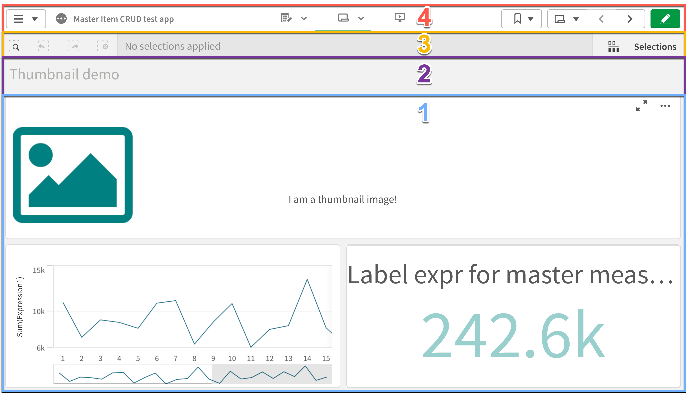

# Sheet Parts (--includesheetpart)

Choose exactly which parts of a Qlik Sense sheet should be captured for thumbnails and screenshots.

This applies to both Qlik Sense Cloud and Qlik Sense Enterprise on Windows (QSEoW) and is controlled with the `--includesheetpart` option.

## What the values mean

- `1` — Main sheet content only (no sheet title, no selection bar)
- `2` — Sheet content + the sheet title
- `3` — Sheet content + title + the current selections bar
- `4` — Full page, including the top menu/toolbar

Default: `1` (content only).



## When to use each option

- Pick `1` when the visual content should dominate, and titles/selections would distract.
- Pick `2` when the sheet title adds useful context to the thumbnail.
- Pick `3` to include the current selections bar, helpful in demos and tutorials.
- Pick `4` for a complete page view, useful for documentation or audits.

Notes:

- If there are no active selections, the selection bar (part of option `3`) may not be visible.
- The browser window is always 1230 × 810 pixels, and an extended sheet shows only its top part. See [What fits in a thumbnail](#what-fits-in-a-thumbnail).

## What fits in a thumbnail {#what-fits-in-a-thumbnail}

Butler Sheet Icons opens each sheet in a browser window that is always **1230 × 810 pixels**. That is large enough for the picture to stay sharp when Qlik Sense shrinks it to thumbnail size. The window size is fixed: no option changes it, and the page is not zoomed.

`--includesheetpart` chooses which part of that window becomes the thumbnail. Value `4` is the whole page, and the lower values are smaller areas inside it. With the default, `1`, the thumbnail shows the sheet's objects as they appear on screen. Anything a user would have to scroll down to see is not in it.

On Qlik Sense Enterprise on Windows, a higher value never shows more of the sheet itself, because every value is cut from the same window. What a higher value adds is Qlik Sense's own elements around the sheet: `2` adds the sheet title, and `4` also adds the menu and toolbar at the top of the page.

Images are not resized. The capture is uploaded at the size it was taken, and Qlik Sense scales it down when it displays it.

### Extended sheets {#extended-sheets}

Qlik Sense lets a sheet be taller than the screen. You switch on **Extend sheet** under **Sheet properties**, and each extension adds 50% of the sheet's original height. The sheet then scrolls vertically.

Butler Sheet Icons captures the sheet as it first opens, scrolled to the top. With the default sheet part, an extended sheet's thumbnail therefore shows only its upper part:

| The sheet is…           | The thumbnail shows… |
| ----------------------- | -------------------- |
| Not extended            | The whole sheet      |
| Extended once (150%)    | The top two-thirds   |
| Extended twice (200%)   | The top half         |
| Extended 3 times (250%) | The top two-fifths   |

On Qlik Sense Enterprise on Windows, choosing another `--includesheetpart` value does not change this. Every value ends at the same point on the sheet.

::: tip A sheet can be extended without anyone meaning to
Dropping an object on the drop zone at the bottom of a sheet also extends the sheet. If thumbnails look cut off, check the sheet even if nobody remembers switching **Extend sheet** on.
:::

For the whole sheet to be in its thumbnail, make it fit on one screen, which means not extended. Otherwise, place whatever makes the sheet recognisable near the top. A thumbnail is there to help users find a sheet, not to show every chart on it.

Qlik's own help describes extending sheets in the section "Extending the sheet area". For Qlik Sense Enterprise on Windows see [Structuring an app using sheets](https://help.qlik.com/en-US/sense/May2026/Subsystems/Hub/Content/Sense_Hub/Sheets/create-sheets-for-structure.htm). For Qlik Sense Cloud see [Changing sheet layouts](https://help.qlik.com/en-US/cloud-services/Subsystems/Hub/Content/Sense_Hub/Sheets/changing-sheet-layout.htm).

If a thumbnail is missing the bottom of its sheet, see [The thumbnail shows only the top of the sheet](/guide/troubleshooting#thumbnail-shows-only-the-top-of-the-sheet).

## Examples

### QS Cloud

::: code-group

```bash [Bash]
butler-sheet-icons qscloud create-sheet-icons \
  --tenanturl <tenant.eu.qlikcloud.com> \
  --apikey <api-key> \
  --logonuserid <user@company.com> \
  --logonpwd <password> \
  --appid <app-id> \
  --includesheetpart 2
```

```powershell [PowerShell]
butler-sheet-icons qscloud create-sheet-icons `
  --tenanturl <tenant.eu.qlikcloud.com> `
  --apikey <api-key> `
  --logonuserid <user@company.com> `
  --logonpwd <password> `
  --appid <app-id> `
  --includesheetpart 2
```

:::

### QSEoW

::: code-group

```bash [Bash]
butler-sheet-icons qseow create-sheet-thumbnails \
  --host <qlik-server.company.com> \
  --apiuserdir Internal \
  --apiuserid sa_api \
  --logonuserdir Internal \
  --logonuserid <username> \
  --logonpwd <password> \
  --sense-version 2024-Nov \
  --appid <app-id> \
  --includesheetpart 3
```

```powershell [PowerShell]
butler-sheet-icons qseow create-sheet-thumbnails `
  --host <qlik-server.company.com> `
  --apiuserdir Internal `
  --apiuserid sa_api `
  --logonuserdir Internal `
  --logonuserid <username> `
  --logonpwd <password> `
  --sense-version 2024-Nov `
  --appid <app-id> `
  --includesheetpart 3
```

:::

## See also

- QSEoW commands: [/reference/qseow](/reference/qseow)
- QS Cloud commands: [/reference/qscloud](/reference/qscloud)
- Browser management (for debugging): [/guide/concepts/browser-management](/guide/concepts/browser-management)
- A thumbnail that shows only the top of its sheet: [/guide/troubleshooting#thumbnail-shows-only-the-top-of-the-sheet](/guide/troubleshooting#thumbnail-shows-only-the-top-of-the-sheet)
- How it works (architecture and flow): [/guide/concepts/how-it-works](/guide/concepts/how-it-works)

## Valid values are checked before the run starts

::: warning Requires BSI 4.1.0 or later
In earlier versions an invalid value was accepted and the run began. The error appeared much later — after certificates were checked, connections opened and the browser started.
:::

`--includesheetpart` is now validated by the command line itself, so a wrong value costs a second rather than a failed run:

```
error: option '--includesheetpart <value>' argument '9' is invalid. Allowed choices are 1, 2, 3, 4.
```

The valid values also appear in `--help`, so they can be found without leaving the terminal. They differ between the two back ends, which is deliberate rather than an oversight:

| Command | Valid values |
|---|---|
| `qseow create-sheet-thumbnails` | `1`, `2`, `3`, `4` |
| `qscloud create-sheet-thumbnails` | `1`, `2`, `4` — `3` (selection bar) has no Qlik Sense Cloud equivalent |

The same check applies to values supplied through `BSI_QSEOW_CST_INCLUDE_SHEET_PART` and `BSI_QSCLOUD_CST_INCLUDE_SHEET_PART`, with a message naming the variable the value came from.
